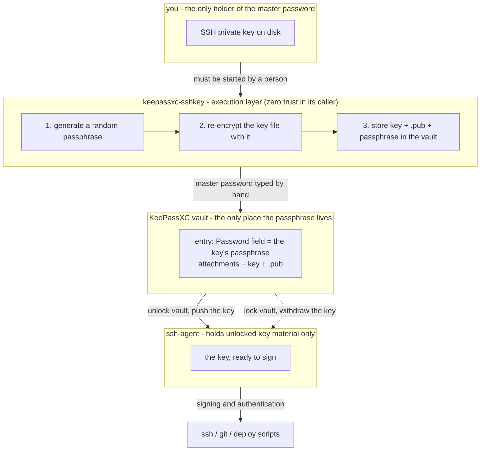

# keepassxc-sshkey

**English** | [中文](README.zh-CN.md)

**Put an SSH private key into a KeePassXC vault, protected by a passphrase that nobody has to remember.**

## The problem

You generate an SSH key, and now there is a private key file on disk. Two options, both bad:

- **Leave it without a passphrase** — anyone who copies the file owns the key. A backup, a sync folder, a stolen laptop, a rootkit: the file is usable the moment it leaves your disk.
- **Give it a passphrase** — now you have another secret to invent, store, and remember. Which is exactly the problem a password manager was supposed to solve.

And then there is the third problem, the one that shows up when you let an AI agent or a script drive your tooling: **anything that can run a command can go looking for your keys.** A password manager whose contents can be extracted by a script is not protecting anything.

## What this does

Point it at a private key file:

```sh
keepassxc-sshkey ~/.ssh/id_ed25519 --db ~/vault.kdbx
```

It then, in one pass:

1. **generates** a strong random passphrase (32 characters, crypto-grade randomness)
2. **re-encrypts** the key file with that passphrase, in place
3. **stores** the key and its `.pub` as attachments in a KeePassXC entry
4. **stores** the passphrase in that entry's Password field

Afterwards the passphrase exists **only inside your vault**. You never see it, never type it, never have to remember it. The file on disk is protected.

## How it fits together



One line to read it by: **the passphrase only ever exists between the vault and ssh-agent - neither the human nor the tool at either end has to remember or see it.**

## Design: it is an execution layer, built for zero trust in the caller

This tool assumes the thing invoking it may be hostile — a script, an agent, a compromised process. It is written so that such a caller **gains nothing** by running it:

| Property | Why |
|---|---|
| **Refuses to run without a tty** | Piped input or captured output means an automated caller. It stops. |
| **Reads the vault password only from the terminal** | Never from `argv`, never from `stdin`, never from the environment. There is no flag to change this. |
| **Never prints the generated passphrase** | The only copy goes into your vault. A caller has nothing to read back. |
| **Never writes the passphrase to disk** | It travels to `keepassxc-cli` through a pipe. No temp files. |
| **No `--password` flag, no env var** | There is deliberately no channel for a caller to supply or extract secrets. |
| **Single file, no dependencies** | Auditable in one sitting. |

### One exposure that cannot be removed, stated plainly

`ssh-keygen` accepts a new passphrase only as a command line argument — it offers no stdin mode and its interactive prompt requires a real terminal. So for the fraction of a second that `ssh-keygen` runs, the passphrase is visible in the local process table.

This is a property of OpenSSH, not of this tool. What this tool does is **keep that window from being watched**: because non-interactive use is refused, no script or agent can sit there polling the process list while the tool runs. It also means the only way to trigger the window is for a human to start the tool at a terminal.

If that single limitation matters in your threat model, note that `--no-reencrypt` narrows it but does not remove it: the key keeps its existing passphrase instead of a new one, but that **existing** passphrase is still passed to `ssh-keygen` once, on a **throwaway copy**, to prove it really opens the key (so that a typo cannot end up stored in the vault). The copy is deleted right after; the key file itself is never touched.

## Requirements

- **OpenSSH** (`ssh-keygen` on PATH)
- **KeePassXC 2.6+** (`keepassxc-cli` on PATH)
- **Python 3.9+**

No third-party Python packages.

## Install

```sh
curl -O https://raw.githubusercontent.com/<you>/keepassxc-sshkey/main/keepassxc_sshkey.py
chmod +x keepassxc_sshkey.py
```

Or clone and run it in place. There is nothing to build.

## Graphical interface

If you would rather not type a command line:

```sh
keepassxc-sshkey --gui
```

or run `keepassxc_sshkey_gui.py` directly. Needs tkinter, which python.org
builds on Windows and macOS include; on Debian/Ubuntu install `python3-tk`.

Pick the private key, pick the vault, type the entry name and the master
password, press **Store in vault**. The generated passphrase is **not
displayed and not logged** — its only copy goes into your vault.

Both interfaces share the same core, and that core returns a status object
with no secret fields in it. The GUI differs in one respect: it cannot
check for a terminal (a window has no tty), so instead it relies on being
operated by a person. The master password is read from a masked field,
held in memory for the run, and cleared from the widget the moment the run
ends.

## Usage

```sh
# simplest form
keepassxc-sshkey ~/.ssh/id_ed25519 --db ~/vault.kdbx

# set the vault once, then skip --db
export KPXC_DB=~/vault.kdbx
keepassxc-sshkey ~/.ssh/id_ed25519

# choose the entry name yourself
keepassxc-sshkey ~/.ssh/deploy --db ~/vault.kdbx --entry "GitHub - deploy"

# see what would happen, change nothing
keepassxc-sshkey ~/.ssh/id_ed25519 --db ~/vault.kdbx --dry-run

# key already has a passphrase and you want to keep it
keepassxc-sshkey ~/.ssh/id_ed25519 --db ~/vault.kdbx --no-reencrypt
```

### Options

| Flag | Meaning |
|---|---|
| `--db PATH` | Path to the `.kdbx` vault. Falls back to `$KPXC_DB`. |
| `--entry NAME` | Entry name in the vault. Defaults to the key's file name. |
| `--passphrase-length N` | Length of the generated passphrase (default 32). |
| `--kdf-rounds N` | bcrypt rounds for the new passphrase (default 24). |
| `--no-reencrypt` | Keep the key's current passphrase (verified against the key first); just store it. |
| `--no-backup` | Do not keep a `<key>.orig` copy. |
| `--ssh-keygen PATH` | Explicit path to `ssh-keygen`. |
| `--keepassxc-cli PATH` | Explicit path to `keepassxc-cli`. |
| `--dry-run` | Print the plan, touch nothing. |

## What it does to your key file

- The key file is **re-encrypted in place** — same key, same public key, new lock. Servers and services that already trust this key keep working; the fingerprint does not change.
- A copy of the previous version is kept as `<key>.orig` unless you pass `--no-backup`.
- If anything fails during re-encryption, the original is restored before the tool exits.
- The vault is only touched **after** the new passphrase has been verified to open the key file.
- With `--no-reencrypt` the same gate applies: your existing passphrase is first verified against a **throwaway copy**, and the vault is only touched once it has been proven to open the key. The original file is not modified.

## Using the key afterwards

Open the vault in KeePassXC. You have two ways to use the key:

1. **Push it to ssh-agent** — in the entry's *SSH Agent* tab, pick the private-key attachment and tick the auto-load/auto-remove boxes. KeePassXC reads the entry's Password field to unlock it, so it happens without any typing.
2. **Copy the passphrase** — when `ssh` asks for it, copy the value out of the entry's Password field.

## Exit codes

| Code | Meaning |
|---|---|
| 0 | stored successfully |
| 1 | error, nothing was left half-done |
| 130 | interrupted |

## License

MIT
