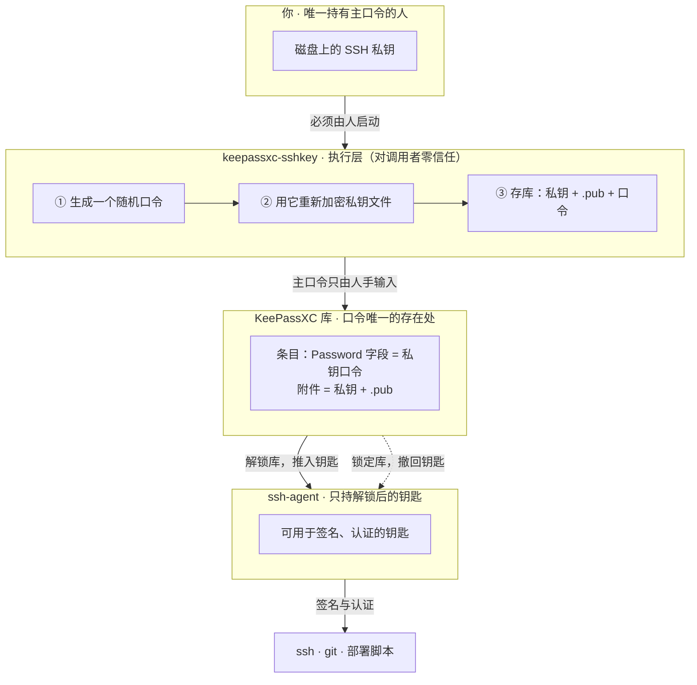

# keepassxc-sshkey

[English](README.md) | **中文**

**把 SSH 私钥存进 KeePassXC，并且给它配一个不需要任何人记住的 passphrase。**

## 先说麻烦

你生成了一把 SSH 钥匙。现在磁盘上躺着一个私钥文件。两条路，都不好：

- **不设 passphrase** —— 谁把这个文件拷走，谁就拿到了这把钥匙。备份、同步盘、丢了的笔记本、一个木马，都算数。文件离开你的磁盘那一刻，它就是可用的。
- **设一个 passphrase** —— 于是你又多了一个要编、要存、要记的秘密。而"不用记密码"本来就该是密码管理器解决的事。

还有第三种麻烦，是当你让 AI agent 或脚本去驱动工具时才会暴露的：**任何能执行命令的东西，都能顺手去找你的钥匙。** 一个内容能被脚本抽出来的密码管理器，保护不了任何东西。

## 这个工具做什么

把私钥文件交给它：

```sh
keepassxc-sshkey ~/.ssh/id_ed25519 --db ~/vault.kdbx
```

它一次做完四件事：

1. **生成**一个强随机 passphrase（32 位，密码学级随机）
2. **用它重新加密**你磁盘上的私钥文件（原地改）
3. **把私钥和 `.pub` 存进** KeePassXC 的条目附件
4. **把 passphrase 写进**那个条目的 Password 字段

做完之后，passphrase **只存在于你的库里**。你看不到它、不用输它、不用记它。而磁盘上那个文件是被保护的。

## 技术路线图



一句话读法：**这把钥匙的 passphrase 从生成到使用，全程只在「库 → ssh-agent」这一段里存在过**，两端的「人」和「工具」都不需要记住或看到它。

## 设计：它是执行层，对调用者零信任

这个工具假设调用它的东西可能是恶意的 —— 脚本、agent、被劫持的进程。所以它被写成：**这类调用者跑它，什么也拿不到。**

| 性质 | 为什么 |
|---|---|
| **没有终端就拒绝运行** | 输入被管道接管、输出被抓走，就等于有自动化调用者。它直接停下。 |
| **主口令只从终端读** | 不从命令行、不从 stdin、不从环境变量读。也没有任何开关能改这一点。 |
| **从不打印生成的 passphrase** | 唯一的一份进你的库。调用者没有东西可读回去。 |
| **从不把 passphrase 写进磁盘** | 它通过管道交给 `keepassxc-cli`，没有临时文件。 |
| **没有 `--password` 类参数、没有环境变量** | 故意不留任何通道：既有不了传入，也有不了抽出。 |
| **单文件、无第三方依赖** | 一次读完就能审。 |

### 一个消不掉的暴露，直说

`ssh-keygen` **只接受命令行传新口令** —— 它没有 stdin 模式，交互提示又只认真实终端。所以 `ssh-keygen` 运行的那几十毫秒里，**passphrase 会出现在本机进程表里**。

**这是 OpenSSH 的性质，不是这个工具引入的。** 工具能做的是**不让这个窗口被蹲守**：因为非交互一律拒绝，脚本或 agent 没法守在一边轮询进程列表。这也意味着，能触发这个窗口的只有**人**在终端里启动它。

如果这一点在你的威胁模型里不可接受，注意 `--no-reencrypt` 只能**收窄、不能消除**它：钥匙保持原来的 passphrase、不生成新的，但那个**现有** passphrase 仍会在一份**临时副本**上交给 `ssh-keygen` 一次 —— 用来确认它真的能打开这把钥匙（防止打错的字被原样存进库）。验证完副本即删，**原文件全程不动**。

## 依赖

- **OpenSSH**（`ssh-keygen` 在 PATH 里）
- **KeePassXC 2.6+**（`keepassxc-cli` 在 PATH 里）
- **Python 3.9+**

不需要任何第三方 Python 包。

## 安装

```sh
curl -O https://raw.githubusercontent.com/<you>/keepassxc-sshkey/main/keepassxc_sshkey.py
chmod +x keepassxc_sshkey.py
```

或者直接 clone 下来原地跑。没有编译步骤。

## 图形界面

不想敲命令的话：

```sh
keepassxc-sshkey --gui
```

或者直接运行 `keepassxc_sshkey_gui.py`。需要 Python 带 tkinter —— Windows 和 macOS 上 python.org 的安装包都带；Debian/Ubuntu 上装 `python3-tk`。

界面里选私钥文件、选库、填条目名、输主口令（掩码），点「存入库」。生成的 passphrase **不显示、不进日志** —— 它只进你的库。

两个界面共用同一套内核，而那个内核返回的结果对象里**没有任何敏感字段**。GUI 有一处不同：它检查不了终端（窗口没有 tty 这个概念），所以它依赖的是「必须有人来点」这一点。主口令从掩码输入框读进来，运行期间只在内存里，跑完立刻从控件里清掉。

## 用法

```sh
# 最基本
keepassxc-sshkey ~/.ssh/id_ed25519 --db ~/vault.kdbx

# 设一次库路径，之后不用再传 --db
export KPXC_DB=~/vault.kdbx
keepassxc-sshkey ~/.ssh/id_ed25519

# 自己指定条目名
keepassxc-sshkey ~/.ssh/deploy --db ~/vault.kdbx --entry "GitHub - deploy"

# 只看计划，什么都不改
keepassxc-sshkey ~/.ssh/id_ed25519 --db ~/vault.kdbx --dry-run

# 钥匙本来就有 passphrase，你想保留
keepassxc-sshkey ~/.ssh/id_ed25519 --db ~/vault.kdbx --no-reencrypt
```

### 选项

| 参数 | 含义 |
|---|---|
| `--db PATH` | `.kdbx` 库路径。不传则读 `$KPXC_DB`。 |
| `--entry NAME` | 库里的条目名。默认取钥匙文件名。 |
| `--passphrase-length N` | 生成的 passphrase 长度（默认 32）。 |
| `--kdf-rounds N` | 新 passphrase 的 bcrypt 轮数（默认 24）。 |
| `--no-reencrypt` | 保留钥匙现有的 passphrase；存库前先验证它确实能打开钥匙。 |
| `--no-backup` | 不保留 `<key>.orig` 副本。 |
| `--ssh-keygen PATH` | 显式指定 `ssh-keygen`。 |
| `--keepassxc-cli PATH` | 显式指定 `keepassxc-cli`。 |
| `--dry-run` | 打印计划，不动任何东西。 |

## 它对钥匙文件做了什么

- 私钥文件**原地重新加密** —— 同一把钥匙、同一个公钥、换一把锁。**已经信任这把钥匙的服务器和服务照常工作，指纹不变。**
- 旧版本会保留一份 `<key>.orig`，除非你传 `--no-backup`。
- 重新加密过程中任何一步失败，**原文件会被恢复**再退出。
- **只有在确认新 passphrase 能打开钥匙文件之后**，工具才会去动你的库。
- 用 `--no-reencrypt` 时同样有这道闸：先在**一份临时副本**上验证你输入的现有 passphrase 能打开这把钥匙，验证通过才动库；原文件不受影响。

## 之后怎么用这把钥匙

用 KeePassXC 打开库，有两条路：

1. **推给 ssh-agent** —— 在条目的 *SSH 代理* 标签里选中私钥附件，勾上"解锁时添加 / 锁定时移除"。KeePassXC 会从条目的 Password 字段取口令去解锁，**全程不需要你输入**。
2. **复制 passphrase** —— `ssh` 问你要的时候，从条目的 Password 字段里复制。

## 退出码

| 码 | 含义 |
|---|---|
| 0 | 成功入库 |
| 1 | 出错，没有留下做到一半的状态 |
| 130 | 被中断 |

## 许可

MIT
